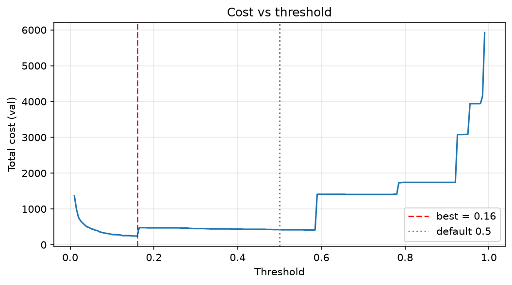

# Credit Card Fraud Detection — End-to-End ML Pipeline (Real Data)

**Important:** This project uses the real Kaggle ULB Credit Card Fraud Detection dataset. The test set was evaluated once using a frozen model, and the reported metrics reflect that held-out evaluation. With very few fraud cases, performance estimates have substantial uncertainty and should not be interpreted as guaranteed real-world performance.

## Problem Statement

Credit card fraud is rare but expensive to miss. In a highly imbalanced dataset, a model can achieve more than 99% accuracy simply by predicting every transaction as legitimate while detecting no fraud at all.

This project builds a leakage-aware machine learning pipeline that focuses on fraud detection performance, honest evaluation, cost-sensitive decisions, explainability, deployment, and drift monitoring.

The primary evaluation metric is **PR-AUC (Average Precision)**, supported by Recall at a fixed precision and bootstrap confidence intervals.

## Dataset

The project uses the real Kaggle [Credit Card Fraud Detection dataset](https://www.kaggle.com/datasets/mlg-ulb/creditcardfraud).

- **Original dataset:** 284,807 transactions
- **Fraud cases before deduplication:** 492
- **Duplicate rows removed:** 1,081
- **Final dataset:** 283,726 transactions
- **Fraud cases after deduplication:** 473
- **Fraud rate after deduplication:** approximately 0.167%
- **Features:** `Time`, `V1`–`V28`, `Amount`, and `Class`

The `V1`–`V28` features are anonymized PCA components. The dataset covers approximately two days of transactions.

Download `creditcard.csv` from Kaggle and place it inside `data/`. The raw dataset and generated model files are excluded from Git.

### Time-Based Train, Validation and Test Split

| Split | Transactions | Fraud Cases | Fraud Rate |
|---|---:|---:|---:|
| Train (first 70%) | 198,608 | 366 | 0.184% |
| Validation (next 15%) | 42,559 | 55 | 0.129% |
| Test (last 15%) | 42,559 | 52 | 0.122% |

The data is split chronologically rather than randomly. Automated assertions verify that training data precedes validation data, which precedes test data.

## Pipeline

### 1. Data Validation and Preprocessing

- Validate the dataset schema, missing values, target labels, and transaction amounts.
- Remove duplicate rows.
- Split transactions chronologically to reduce temporal leakage.
- Apply `log1p` transformation to transaction amounts.
- Extract cyclical time-of-day features using sine and cosine transformations.
- Fit `RobustScaler` on training data only through the preprocessing pipeline.
- Run automated tests for data splitting and preprocessing.

### 2. Model Training and Imbalance Handling

The project compares multiple models and imbalance-handling strategies.

**Models evaluated:**
- Dummy Classifier baseline
- Logistic Regression
- Random Forest
- XGBoost
- LightGBM

**Imbalance strategies:**
- No resampling
- Class weighting
- SMOTE
- Random undersampling

Resampling is applied only within the training pipeline to prevent validation and test data from leaking into model training.

#### Validation PR-AUC: Imbalance Strategy Comparison

| Model | No Resampling | Class Weight | SMOTE | Undersampling |
|---|---:|---:|---:|---:|
| Dummy Classifier | 0.001 | — | — | — |
| Logistic Regression | 0.757 | 0.810 | 0.803 | 0.541 |
| Random Forest | 0.862 | 0.871 | 0.871 | 0.845 |

Random Forest achieved the same validation PR-AUC with class weighting and SMOTE. However, SMOTE took approximately 10 times longer to train, without improving the score.

### 3. Hyperparameter Tuning and Model Selection

XGBoost and LightGBM were tuned using Optuna with a TPE sampler. Model selection used a four-fold expanding-window `TimeSeriesSplit`, with mean cross-validation PR-AUC as the predefined selection criterion.

MLflow records experiment runs and tuning results.

| Model | CV PR-AUC | Validation PR-AUC | Validation Recall at Precision ≥ 0.80 |
|---|---:|---:|---:|
| **XGBoost (selected)** | **0.783 ± 0.057** | 0.861 | 0.818 |
| LightGBM | 0.776 ± 0.071 | 0.757 | 0.745 |
| Random Forest | 0.762 ± 0.077 | 0.871 | 0.818 |

XGBoost was selected because it achieved the best mean cross-validation PR-AUC under the predefined rule. The differences are within one standard deviation, so the results do not establish that XGBoost is definitively superior to the alternatives.

### 4. Calibration, Threshold Optimization and SHAP

- Compared raw model probabilities, sigmoid calibration, and isotonic calibration.
- Retained the raw model because it achieved the lowest Brier score.
- Optimized a decision threshold on validation data using an assumed cost model.
- Applied exact TreeSHAP contributions to explain predictions.
- Generated feature importance, SHAP summary, calibration, and threshold-cost plots.

The cost model assumes that a missed fraud costs the transaction amount and a false alarm costs 5 units.

The selected validation threshold was **0.16**, compared with the conventional threshold of 0.50.

### 5. Final Held-Out Test Results

The frozen model was evaluated on the held-out test set once. No model tuning was performed after observing the test results.

| Metric | Test Result |
|---|---:|
| **PR-AUC (Average Precision)** | **0.735** |
| 95% Bootstrap Confidence Interval | 0.612–0.847 |
| Recall at Precision ≥ 0.80 | 0.712 |
| ROC-AUC | 0.983 |

ROC-AUC is included for reference, but PR-AUC is the primary metric because fraud is extremely rare.

#### Threshold Comparison on the Test Set

| Threshold | True Positives | False Positives | False Negatives | Precision | Recall | Cost |
|---|---:|---:|---:|---:|---:|---:|
| 0.50 | 37 | 5 | 15 | 0.881 | 0.712 | 2,438 |
| 0.16 | 38 | 19 | 14 | 0.667 | 0.731 | 2,468 |

The threshold of 0.16 reduced validation cost by approximately 43.3% compared with 0.50. However, on the test set, its cost was approximately 1.2% higher than the cost at 0.50.

This illustrates why threshold optimization on a small validation set may not generalize. The API default remains configurable at 0.16, but the results do not establish that it is the optimal production threshold.

### Test Precision-Recall Curve


### Test Confusion Matrix


The confusion matrix is generated at threshold 0.16. At this threshold, the model detects 38 fraud cases, raises 19 false alarms, and misses 14 fraud cases.

### SHAP Explainability


The leading model drivers include `V14`, `V10`, `V17`, and `V4`. These are anonymized PCA features, so their contributions explain model behavior but do not provide direct business-level reasons for a transaction being flagged.

### Cost vs. Threshold



### Why Not Just Use Accuracy?

With approximately 99.83% legitimate transactions after deduplication, a classifier that labels every transaction as legitimate can achieve approximately 99.83% accuracy while detecting zero fraud cases.

Precision, recall, PR-AUC, confidence intervals, and the costs of false alarms and missed fraud provide a more meaningful evaluation.

## Deployment

### FastAPI Inference Service

The model is served through FastAPI with input validation using Pydantic.

| Endpoint | Method | Purpose |
|---|---|---|
| `/health` | GET | Check API health |
| `/model-info` | GET | Retrieve model information, default threshold, and test metrics |
| `/predict` | POST | Score a single transaction and return its fraud probability, decision, top SHAP reasons, and model version |
| `/predict/batch` | POST | Upload a CSV and receive fraud scores for multiple transactions |

The single-transaction endpoint accepts `Time`, `V1`–`V28`, and `Amount`. An optional `threshold` query parameter overrides the default threshold. Batch inference validates columns and numeric values and supports up to 100,000 rows per request.

### Streamlit Dashboard

The dashboard includes three tabs:

- **Single Transaction:** Score a sample or pasted JSON transaction, inspect its prediction, and view SHAP explanations.
- **Batch CSV:** Upload transactions, inspect flagged cases, compare threshold performance, and download scored results.
- **Model Report:** Review evaluation metrics and generated plots.

The dashboard includes a configurable threshold slider with a default value of 0.16.

## Drift Monitoring

The monitoring module compares training data with validation and test data using the Population Stability Index (PSI), Kolmogorov–Smirnov (KS) tests, and model-score drift.

### Observed Drift

| Check | Result |
|---|---|
| Training fraud rate | 0.184% |
| Validation fraud rate | 0.129% |
| Test fraud rate | 0.122% |
| Features with PSI ≥ 0.20 on validation | 6 |
| Features with PSI ≥ 0.20 on test | 7 |
| Model-score PSI (validation → test) | 0.008 |
| Mean model score (validation → test) | 0.00160 → 0.00146 |

The largest test-set feature shifts include `V1` (PSI 1.01), `V3` (0.75), `V28` (0.53), `V11` (0.34), and `V25` (0.29).


The monitoring rule triggered a drift alert based on feature drift, while model-score drift remained low. This is an investigation signal, not proof that the model has failed.

Because the dataset spans approximately two days, time-of-day differences may explain part of the feature shift. This remains a hypothesis that requires further investigation.

Run the monitoring module with:

```bash
python -m src.monitoring.drift
```

## Limitations

- **Small test sample:** Only 52 fraud cases appear in the held-out test set, resulting in a wide confidence interval.
- **Validation-to-test gap:** Validation PR-AUC was 0.861, compared with 0.783 ± 0.057 in cross-validation and 0.735 on the held-out test set.
- **Threshold generalization:** The validation-optimized threshold did not reduce cost on the test set.
- **Assumed costs:** The cost model is illustrative and has not been validated against real financial or operational costs.
- **Anonymized features:** PCA components limit the business interpretability of SHAP reason codes.
- **Short time span:** The dataset covers approximately two days and cannot establish long-term performance or real-world concept drift.
- **No adversarial evaluation:** Resistance to adaptive fraud behavior has not been tested.
- **No production latency benchmark:** API latency has not been measured.
- **No Docker deployment:** Docker was planned but has not been implemented.

The project is an end-to-end research and engineering pipeline, not a production-certified fraud prevention system.

## How to Run

### 1. Download the Dataset

Download `creditcard.csv` from [Kaggle](https://www.kaggle.com/datasets/mlg-ulb/creditcardfraud) and place it inside the `data/` directory.

### 2. Install Dependencies

```bash
pip install -r requirements.txt
```

### 3. Prepare the Data

```bash
python -m src.data.prepare
```

### 4. Compare Models and Imbalance Strategies

```bash
python -m src.models.compare
```

### 5. Tune Gradient Boosting Models

```bash
python -m src.models.tune
```

### 6. Run Calibration, Threshold Optimization and SHAP

```bash
python -m src.models.phase4
```

### 7. Evaluate the Frozen Model on the Test Set

```bash
python -m src.models.final_test
```

Run this step only when you intend to perform the final held-out evaluation. The reported test result was generated once; rerunning it does not constitute a new independent test.

### 8. Start the API

```bash
uvicorn src.api.main:app --port 8000
```

Open [http://localhost:8000/docs](http://localhost:8000/docs) to explore and test the API endpoints.

### 9. Start the Dashboard

```bash
streamlit run app/dashboard.py
```

### 10. Run Tests

```bash
pytest -q
```

The project includes seven automated tests covering chronological splitting, preprocessing, metrics, API responses, input validation, and threshold overrides.

**Note:** Model files and processed data are Git-ignored. Run the preparation and training steps before starting the API or dashboard.

## Project Structure

```text
fraud-detection-system/
├── .github/
│   └── workflows/
│       └── ci.yml
├── app/
│   └── dashboard.py
├── configs/
│   └── config.yaml
├── data/
│   ├── creditcard.csv
│   └── processed/
├── model/
├── notebooks/
│   └── eda.py
├── reports/
│   ├── figures/
│   ├── phase2_results.csv
│   ├── phase3_results.csv
│   ├── phase3_best_params.json
│   ├── phase4_threshold.json
│   ├── final_test_report.json
│   └── drift_report.csv
├── src/
│   ├── data/
│   │   ├── load.py
│   │   ├── validate.py
│   │   ├── split.py
│   │   └── prepare.py
│   ├── features/
│   │   └── preprocess.py
│   ├── models/
│   │   ├── metrics.py
│   │   ├── compare.py
│   │   ├── tune.py
│   │   ├── phase4.py
│   │   └── final_test.py
│   ├── api/
│   │   ├── main.py
│   │   └── schemas.py
│   └── monitoring/
│       └── drift.py
├── tests/
│   ├── test_split.py
│   ├── test_preprocess_metrics.py
│   └── test_api.py
├── conftest.py
├── requirements.txt
├── .gitignore
└── README.md
```

## Tech Stack

Python · pandas · NumPy · scikit-learn · imbalanced-learn · XGBoost · LightGBM · Optuna · MLflow · SHAP · FastAPI · Pydantic · Uvicorn · Streamlit · Matplotlib · Seaborn · SciPy · pytest · GitHub Actions

## Author

**Aadi Gupta** — [GitHub](https://github.com/ag0611)

