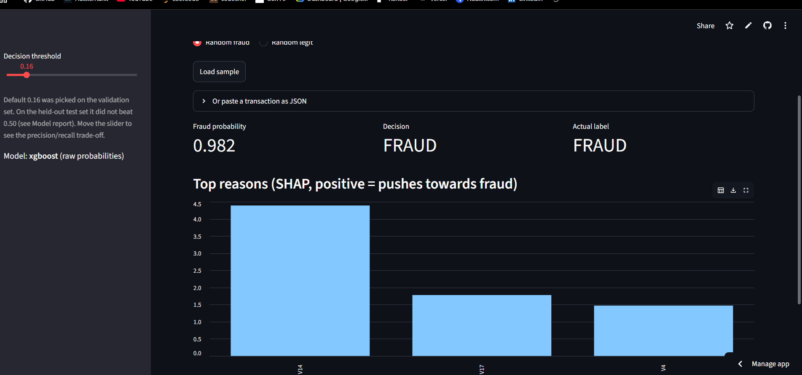
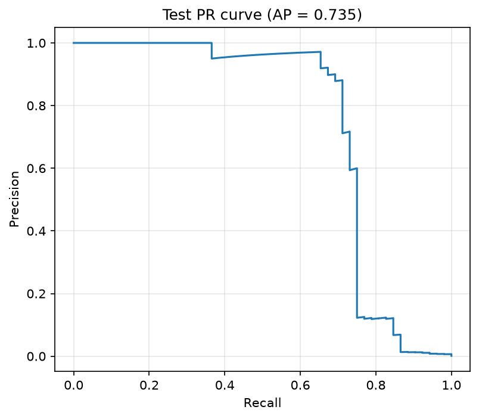
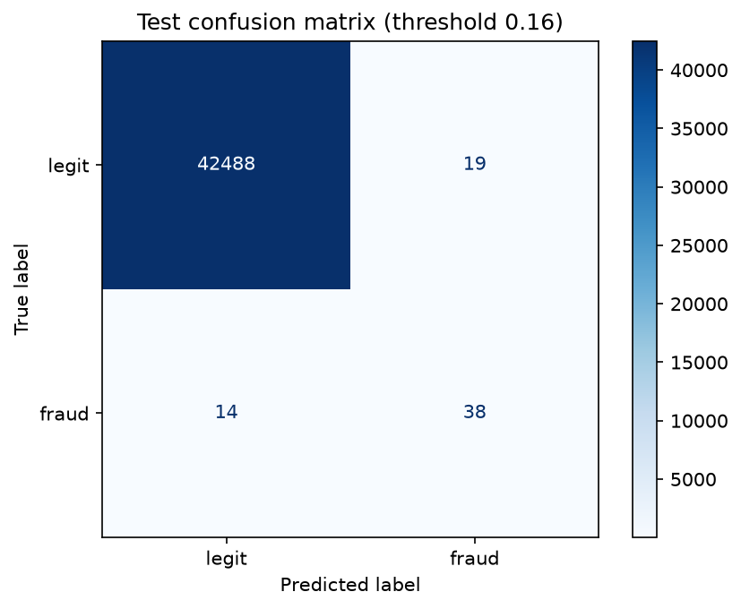
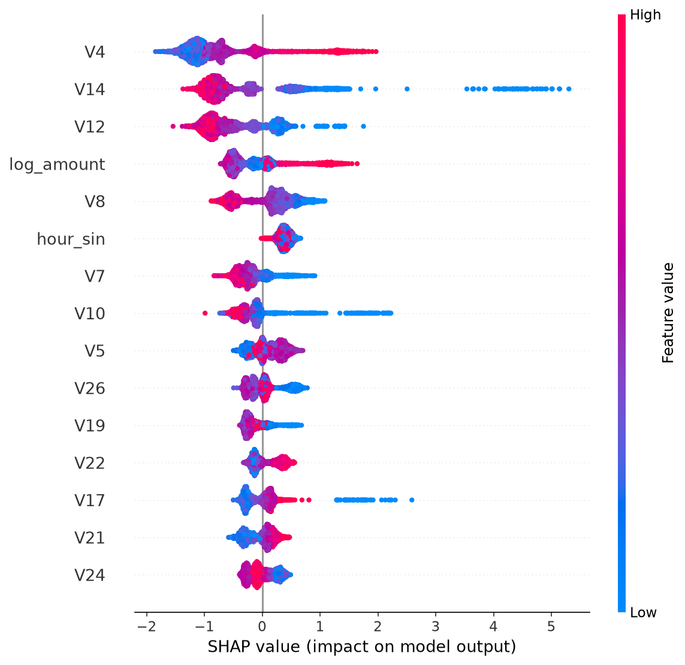
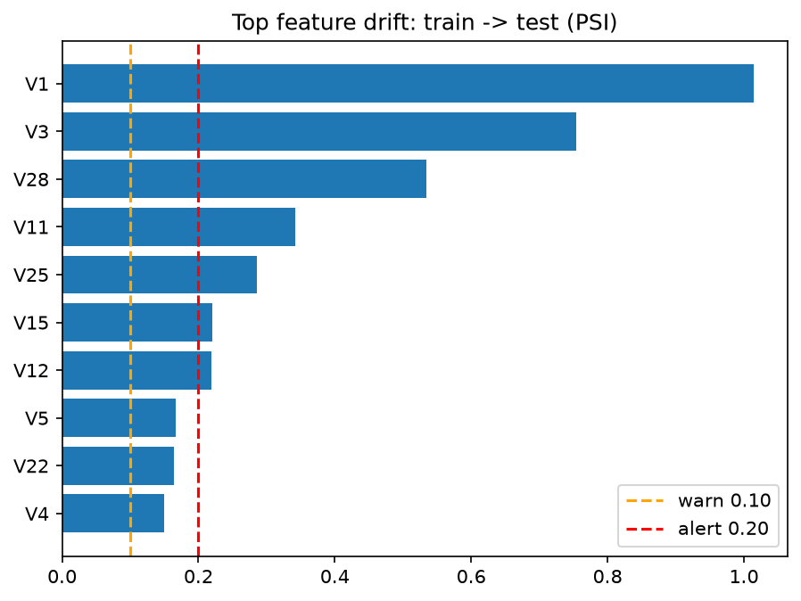

# Credit Card Fraud Detection — End-to-End ML Pipeline

A leakage-aware credit card fraud detection project using real Kaggle data, time-based evaluation, XGBoost, SHAP explainability, FastAPI, Streamlit, and drift monitoring.

**Held-out test results:** PR-AUC **0.735** (95% CI: 0.612–0.847), ROC-AUC **0.983**, and recall **0.712** at precision ≥ 0.80. The frozen model was evaluated on the test set once.

## Dashboard



**Live App:** https://fraud-detection-system-ag.streamlit.app

## Dataset

Uses the [Kaggle Credit Card Fraud Detection dataset](https://www.kaggle.com/datasets/mlg-ulb/creditcardfraud).

- **Transactions:** 283,726 after removing 1,081 duplicate rows.
- **Fraud cases:** 473 (approximately 0.167%).
- **Features:** `Time`, `V1`–`V28`, `Amount`, and `Class`.
- `V1`–`V28` are anonymized PCA features; the dataset spans approximately two days.

Download `creditcard.csv` from Kaggle and place it in `data/`. Raw data and generated model files are excluded from Git.

### Chronological Split

| Split | Transactions | Fraud Cases |
|---|---:|---:|
| Train (70%) | 198,608 | 366 |
| Validation (15%) | 42,559 | 55 |
| Test (15%) | 42,559 | 52 |

The chronological split helps reduce temporal leakage.

## Pipeline

1. **Data preparation:** validate data, remove duplicates, engineer features, and preprocess using training data only.
2. **Model comparison:** evaluate Logistic Regression, Random Forest, XGBoost, LightGBM, and a Dummy Classifier with different imbalance strategies.
3. **Model tuning:** use Optuna and time-series cross-validation; track experiments with MLflow.
4. **Explainability:** compare calibration methods, optimize a validation threshold, and explain predictions using SHAP.
5. **Evaluation and monitoring:** report held-out test metrics and monitor feature drift using PSI and KS tests.

XGBoost was selected using the predefined cross-validation PR-AUC criterion. Validation PR-AUC was 0.861, compared with 0.735 on the held-out test set.

## Test Results

| Metric | Held-out Test |
|---|---:|
| PR-AUC (Average Precision) | **0.735** |
| 95% Bootstrap CI | 0.612–0.847 |
| Recall at Precision ≥ 0.80 | 0.712 |
| ROC-AUC | 0.983 |

### Test Curves

<table>
  <tr>
    <th align="center">Precision–Recall Curve</th>
    <th align="center">Confusion Matrix</th>
  </tr>
  <tr>
    <td width="50%">
      
    </td>
    <td width="50%">
      
    </td>
  </tr>
</table>

The confusion matrix uses threshold **0.16**: 38 fraud cases detected, 19 false alarms, and 14 missed fraud cases.

### Explainability and Drift Monitoring

| SHAP Summary Plot | Feature Drift |
|---|---|
|  |  |

Top SHAP drivers include `V14`, `V10`, `V17`, and `V4`. These are anonymized PCA features, so they explain model behavior rather than direct business reasons.

Feature drift triggered an alert, while model-score drift remained low. This is a signal for investigation, not proof of model failure.

## Deployment

- **FastAPI:** `/health`, `/model-info`, `/predict`, and `/predict/batch` endpoints with input validation and SHAP explanations.
- **Streamlit:** single-transaction prediction, batch CSV scoring, metrics, visualizations, and downloadable results.
- **Live Dashboard:** https://fraud-detection-system-ag.streamlit.app

The default decision threshold is configurable at 0.16. On the test set, this threshold had slightly higher estimated cost than 0.50, so it is not established as the optimal production threshold.

## How to Run

Place the Kaggle `creditcard.csv` file inside `data/`, then run:

```bash
pip install -r requirements.txt
python -m src.data.prepare
python -m src.models.compare
python -m src.models.tune
python -m src.models.phase4
python -m src.models.final_test
uvicorn src.api.main:app --port 8000
streamlit run app/dashboard.py
pytest -q
```

API documentation: http://localhost:8000/docs

Run `final_test` only when intentionally performing the final held-out evaluation. The reported test result was generated once. Prepare and train the model before starting the API or dashboard.

## Project Structure

```text
fraud-detection-system/
├── .github/workflows/ci.yml
├── app/dashboard.py
├── configs/config.yaml
├── data/                  # Local dataset; Git-ignored
├── deploy/                # Streamlit Cloud app
├── docs/dashboard.png     # Dashboard screenshot
├── notebooks/
├── reports/figures/       # Evaluation and monitoring plots
├── src/
│   ├── data/
│   ├── features/
│   ├── models/
│   ├── api/
│   └── monitoring/
├── tests/
├── requirements.txt
└── README.md
```

## Tech Stack

Python · pandas · NumPy · scikit-learn · imbalanced-learn · XGBoost · LightGBM · Optuna · MLflow · SHAP · FastAPI · Pydantic · Streamlit · SciPy · pytest · GitHub Actions

## Author

**Aadi Gupta** · [GitHub](https://github.com/ag0611)
